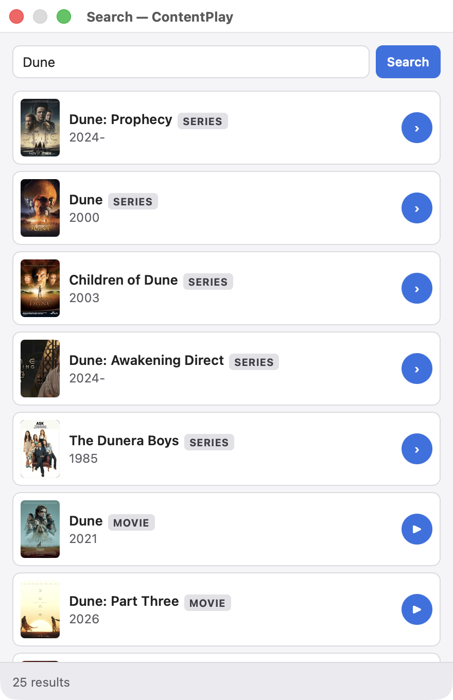

# ContentPlay

An IINA plugin that lets you search a TV series, build its **entire season as a
playlist**, and **play the next episode** natively — sourced from Stremio addons
(Cinemeta for metadata, Torrentio for streams) and resolved through
**Real-Debrid**.

## Screenshots

| Search & recents | Season episodes | Switchable streams |
| --- | --- | --- |
|  |  |  |

| Audio auto-picked | Subtitles auto-picked | Configurable |
| --- | --- | --- |
|  |  |  |

The whole season loads as one playlist, the right **English** audio and subtitle
tracks are chosen automatically over the file's Italian defaults, and everything —
languages, quality, 3D/HDR avoidance, shortcuts — is configurable. When a stream is
wrong, **Plugins ▸ ContentPlay ▸ Streams** lists every alternate for the current
episode to switch to in place.

## How it works

1. **Plugins ▸ Search…** (`⌃⌥⌘F`) — a window opens (works even on IINA's
   welcome screen, no video needed).
2. **Search** a movie or series by name (Cinemeta) or paste an IMDb id like
   `tt0944947`. Recently played titles show up when the search box is empty.
3. Click a movie to play it, or open a series and use **Play Season N**,
   **Play All Seasons**, or ▶ on any episode to play from there.
4. ContentPlay looks up instant (cached) Real-Debrid streams via Torrentio, six
   at a time, skipping episodes that haven't aired, writes an `.m3u` and opens
   it in a new player window.
5. Use IINA's normal controls — the playlist panel, `⌘→`, or "Next" — to walk
   through the season. Each file shows its `S1E05 · Title` label on load.
6. If the auto-picked stream is wrong (a 3D side-by-side file, the wrong audio,
   too big), open **Plugins ▸ ContentPlay ▸ Streams** while it plays — every
   alternate for that episode is listed, with a check on the one in use. Pick one
   and it reloads the episode in place, resumes near the same spot, shows
   `Stream 2/7 · 1080p WEB-DL` on the OSD, and the season keeps auto-advancing.
   (There are also **Next/Previous stream** menu items you can bind to keys in
   Settings; they're unbound by default so they don't get confused with IINA's
   next/previous *episode*.)

Two runtime contexts make this work: a **global** entry (`global.js`) hosts the
always-available menu + panel and does all resolution; the **main** entry
(`index.js`) runs inside the launched player window and builds its playlist.
(IINA's `core`/`playlist` and the sidebar are player-window-only, which is why
the panel is a global standalone window rather than a sidebar tab.)

The "easy" path embeds your Real-Debrid key into the Torrentio config
(`realdebrid=<key>`), so Torrentio hands back already-resolved, directly
playable RD links. If a stream only exposes a raw `infoHash`, the plugin falls
back to the Real-Debrid API directly (`addMagnet → selectFiles → unrestrict`).

## Install

Requires IINA 1.4.0 or newer (plugin support). Pick either:

- **From a release (recommended):** download `ContentPlay.iinaplgz` from the
  [latest release](https://github.com/Arnav12S/iina-contentplay/releases/latest) and open
  it with IINA, or go to **Settings ▸ Plugins ▸ Install Local Package…** and choose it.
- **From GitHub inside IINA:** **Settings ▸ Plugins ▸ Get Plugins…** → *Install from GitHub*
  and paste `Arnav12S/iina-contentplay`. IINA then auto-checks this repo for updates.

After installing you'll get **Search…** (`⌃⌥⌘F`) under the **Plugin** menu.

### Develop

To hack on it, symlink this folder into IINA's plugin directory as a dev package and restart
IINA (dev packages show a `DEV` badge and are not auto-updated):

```sh
"/Applications/IINA.app/Contents/MacOS/iina-plugin" link "$(pwd)"
# or: ln -s "$(pwd)" "$HOME/Library/Application Support/com.colliderli.iina/plugins/com.arnav.contentplay.iinaplugin-dev"
```

`iina-plugin pack .` builds a `.iinaplgz` for a release.

## Setup

1. Get your Real-Debrid API token: <https://real-debrid.com/apitoken>
2. In IINA: **Settings ▸ Plugins ▸ ContentPlay** and paste it.
3. (Optional) Everything else is configurable on that same settings page — preferred
   quality, the audio/subtitle languages, 3D/HDR avoidance, Torrentio filters, keyboard
   shortcuts, and the addon URLs. Nothing is hardcoded to one person's taste, so you can
   tune it to yours. See **Configuration** below.

## Using it

- **Open:** **Plugins ▸ Search…** or `⌃⌥⌘F`.
- **Keyboard:** the search box is focused on open; `/` jumps back to it from
  anywhere in the window; `Enter` searches; `Esc`
  cancels a running lookup, goes back from a series, or clears the search.
- **Errors** show in red at the bottom; click them for the detailed log.

## Configuration

All settings live in **Settings ▸ Plugins ▸ ContentPlay**:

| Setting                       | Default                               | What it does                                                                 |
| ----------------------------- | ------------------------------------- | --------------------------------------------------------------------------- |
| Real-Debrid API token         | —                                     | Required; resolves playable links.                                          |
| Preferred quality             | `720p`                                | Preferred when an instant stream exists in it. `4K` also re-enables 4K/HDR. |
| Avoid 3D / side-by-side       | on                                    | Keeps 3D/SBS/half-OU/anaglyph from being auto-picked (still switchable).     |
| Avoid 4K / HDR                | on                                    | Down-ranks 2160p/HDR/DV unless Preferred quality is 4K (still switchable).   |
| Languages you understand      | `en,hi,te`                            | Gates the `orig` token in Audio priority.                                    |
| Audio priority                | `orig,te,en`                          | Ordered audio preference (see below).                                       |
| Subtitle languages            | `en`                                  | First one is fetched from OpenSubtitles when the stream has no sub track.    |
| Torrentio filters             | `sort=qualitysize\|qualityfilter=…`   | Passed to Torrentio; hides cam/screener rips by default.                     |
| Alternate streams kept        | `6`                                   | How many switchable streams to keep per item.                               |
| Parallel lookups              | `6`                                   | Streams resolved at once when building a season.                            |
| Keyboard shortcuts            | see below                             | Open/close search, next/previous stream.                                    |
| Cinemeta / Torrentio / OpenSubtitles URLs | public community addons   | Point at your own mirrors if needed.                                        |

Default shortcuts: open search `⌃⌥⌘F`, close search `⌃⌥⌘W`. The next/previous-stream
shortcuts are unbound by default (switch streams from the **Streams** menu instead); bind
them in Settings if you want. Shortcut changes apply after IINA restarts.

## Audio & subtitle languages

ContentPlay looks up each title's original language on Wikidata (by IMDb id; falls back to
Cinemeta's country), then chooses audio by walking **Audio priority** left to right:

- a language code (`en`, `te`, …) matches that dub/track;
- `orig` matches the title's **original** language — but only when that original is one of
  the **languages you understand**, otherwise `orig` is skipped and the next token wins.

So the default `understood = en,hi,te` + `priority = orig,te,en` means *"original if I
understand it, else a Telugu dub, else English"*:

| Original language                  | Audio chosen                        |
| ---------------------------------- | ----------------------------------- |
| English, Hindi, Telugu             | Original                            |
| Other Indian (Tamil, Malayalam, …) | Telugu dub, else English, else orig |
| Korean, Spanish, …                 | Telugu dub, else English, else orig |

Audio priority is a single global order, so a non-understood original (e.g. Korean) prefers
a Telugu dub over English *if one exists*. Set `priority = orig,en` to always fall back to
English instead. Stream picking prefers releases that name the wanted audio language (then
multi/dual-audio ones) before quality.

Subtitles default to English. If a stream has no matching subtitle track, ContentPlay
downloads subtitles in the first configured language from OpenSubtitles (via its Stremio
addon) and loads them.

## Notes & limits

- Instant playback relies on the torrent being **cached** on Real-Debrid
  (Torrentio marks these `[RD+]`). Uncached picks go through the slower
  addMagnet flow and may take a bit.
- Torrentio and Cinemeta are public community services; availability varies. You
  can point them (and OpenSubtitles) at your own mirrors in the settings page.
- `allowedDomains` in `Info.json` scopes the plugin's network access to
  `*.strem.io`, `*.strem.fun`, and `*.real-debrid.com`. Actual video playback is
  handled by mpv, which follows RD's redirect to its CDN.
- This is a personal media tool for use with your own paid Real-Debrid account.

## Files

| File            | Purpose                                                      |
| --------------- | ------------------------------------------------------------ |
| `Info.json`     | Plugin manifest (permissions, entries, defaults)             |
| `global.js`     | Global entry: menu, panel, Stremio + RD resolution, launch   |
| `index.js`      | Main entry: receives the queue, builds the window's playlist |
| `ui/panel.html` | Panel UI (search, seasons, episodes)                         |
