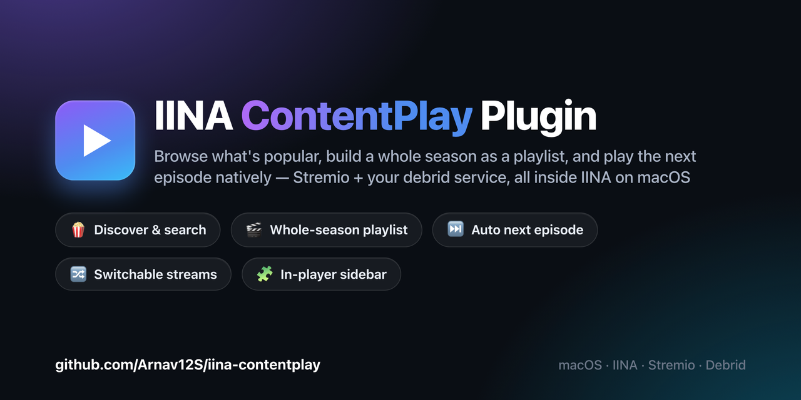
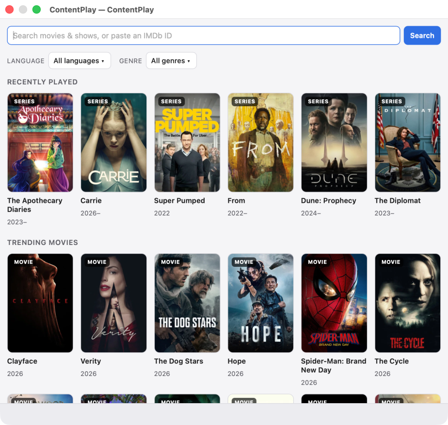
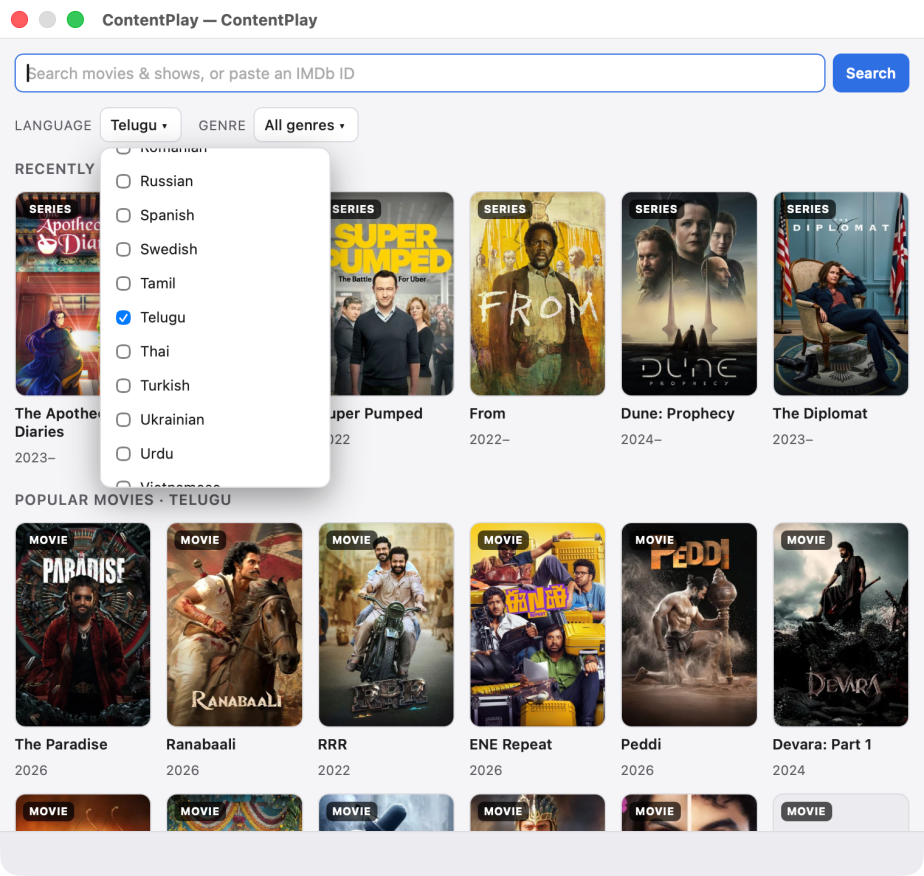
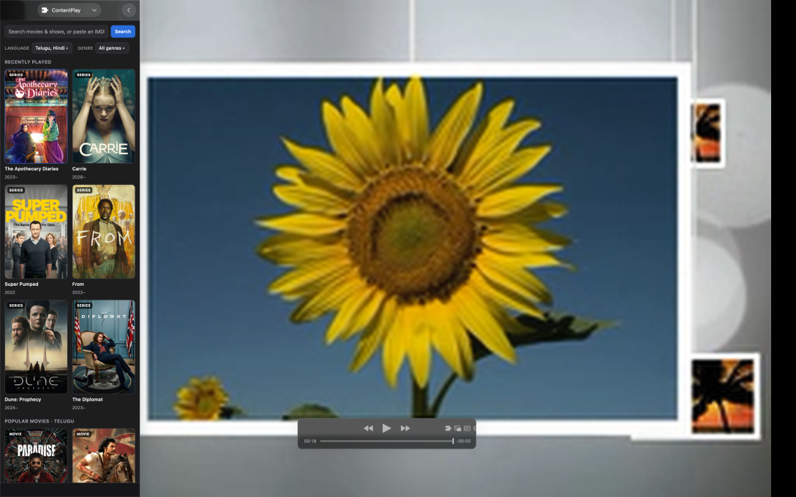
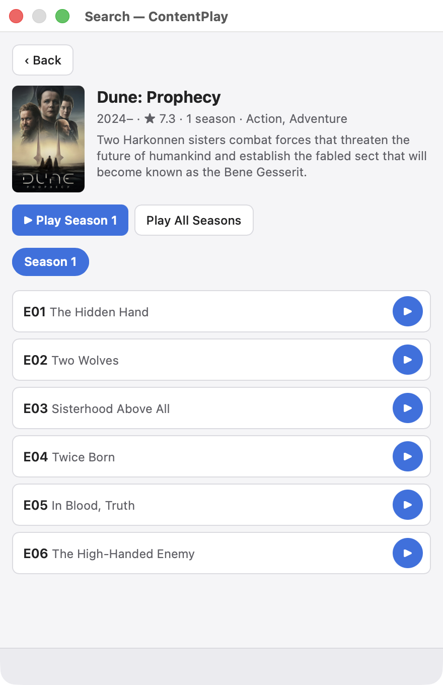
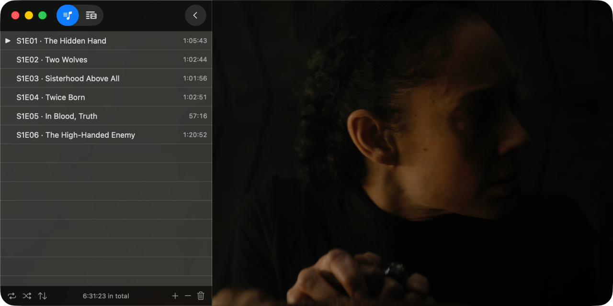
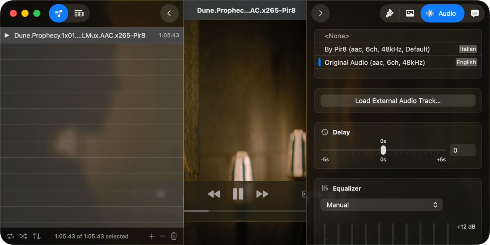
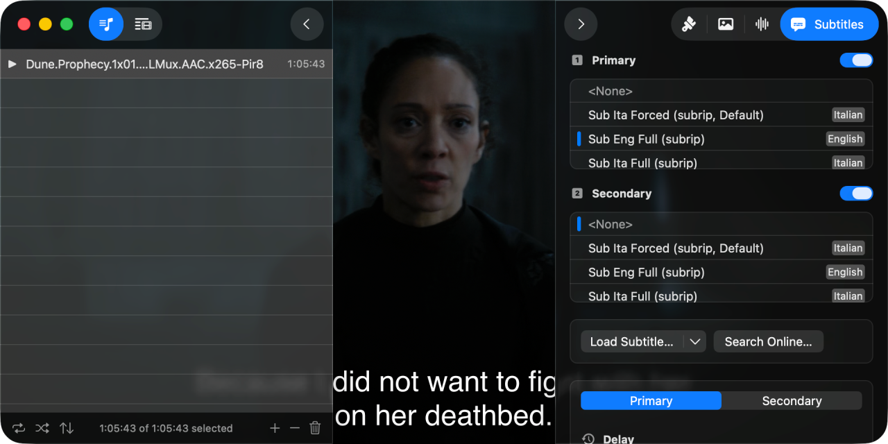
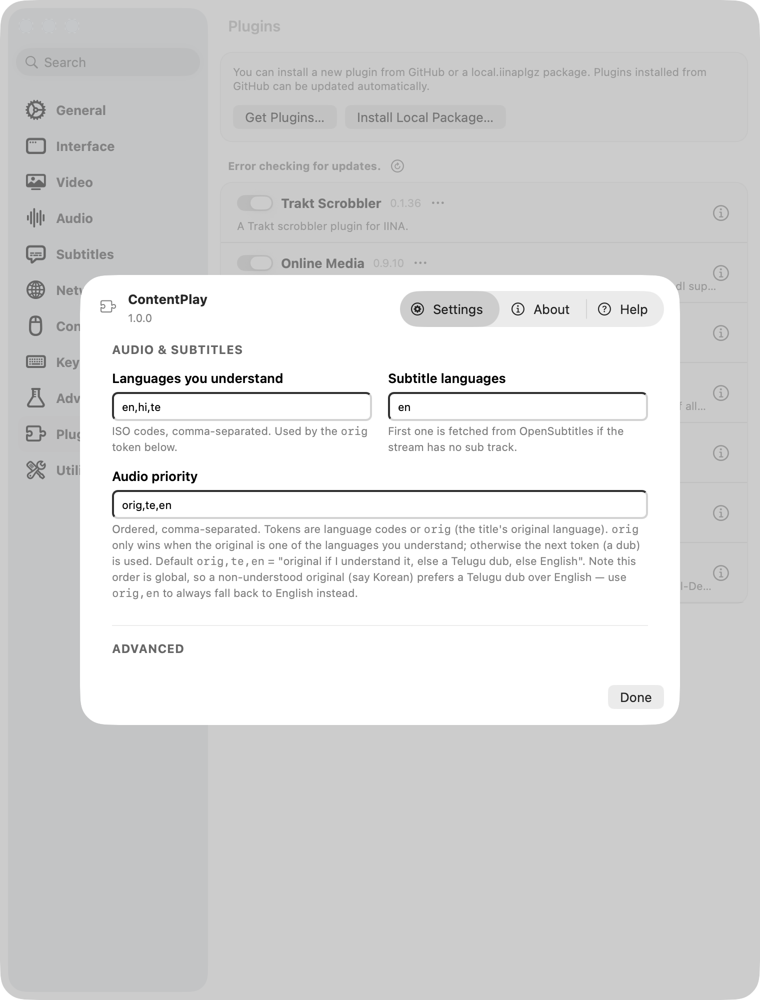
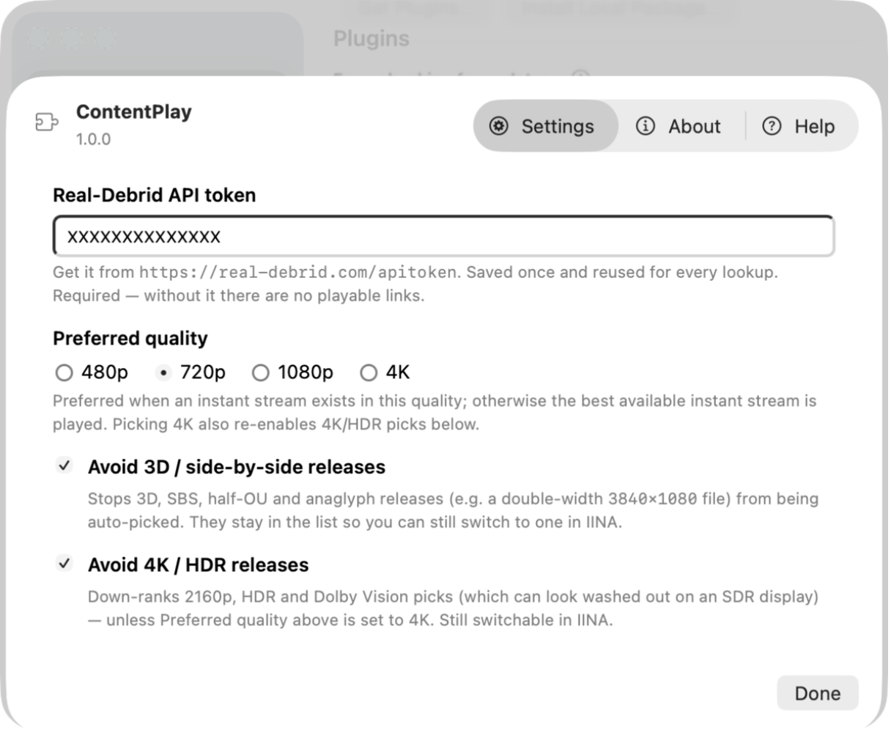

<p align="center">
  
</p>

# ContentPlay

An IINA plugin that lets you **browse what's popular**, search a TV series, build
its **entire season as a playlist**, and **play the next episode** natively —
sourced from Stremio addons (Cinemeta for metadata, Torrentio for streams) and
resolved through your **debrid service**: Real-Debrid, TorBox, AllDebrid,
Premiumize, Debrid-Link, Offcloud, EasyDebrid or Put.io. A **Discover** screen
(and an in-player **sidebar tab**) means you never have to open a browser to find
something to watch.

## Screenshots

| Discover — browse what's popular | Language & genre filtering | In-player sidebar |
| --- | --- | --- |
|  |  |  |

| Season episodes | Switchable streams | Audio auto-picked |
| --- | --- | --- |
|  |  |  |

| Subtitles auto-picked | Settings — languages | Settings |
| --- | --- | --- |
|  |  |  |

The Discover screen (and the ContentPlay sidebar tab, shown above beside the
playing video) browse what's trending/popular with friendly Language and Genre
multi-selects — here showing **Popular in Telugu** and per-language **Latest**
rows with a TMDB key set.

The whole season loads as one playlist, the right **English** audio and subtitle
tracks are chosen automatically over the file's Italian defaults, and everything —
languages, quality, 3D/HDR avoidance, shortcuts — is configurable. When a stream is
wrong, **Plugins ▸ ContentPlay ▸ Streams** lists every alternate for the current
episode to switch to in place.

## How it works

**Hover cards:** hover any poster or episode for the summary, cast, director and IMDb / Letterboxd ratings (Rotten Tomatoes with a free OMDb key in Settings).

1. **Plugins ▸ Discover & Search…** (`⌃⌥⌘F`) — a window opens (works even on
   IINA's welcome screen, no video needed). It lands on **Discover**: poster
   rows of what's Popular, New This Year and Top Rated, with **Language** and
   **Genre** filters and your Recently-played at the top.
2. **Search** a movie or series by name (Cinemeta) or paste an IMDb id like
   `tt0944947` — just type in the box and Discover gives way to results.
   Clearing the box returns to Discover.
3. Click a movie to play it, or open a series and use **Play Season N**,
   **Play All Seasons**, or ▶ on any episode to play from there.
4. ContentPlay looks up instant (cached) streams on your debrid service via
   Torrentio, six at a time, skipping episodes that haven't aired, writes an
   `.m3u` and opens it in a new player window.
5. Use IINA's normal controls — the playlist panel, `⌘→`, or "Next" — to walk
   through the season. Each file shows its `S1E05 · Title` label on load.
6. If the auto-picked stream is wrong (a 3D side-by-side file, the wrong audio,
   too big), open **Plugins ▸ ContentPlay ▸ Streams** while it plays — every
   alternate for that episode is listed, with a check on the one in use. Pick one
   and it reloads the episode in place, resumes near the same spot, shows
   `Stream 2/7 · 1080p WEB-DL` on the OSD, and the season keeps auto-advancing.
   (There are also **Next/Previous stream** menu items you can bind to keys in
   Settings; they're unbound by default so they don't get confused with IINA's
   next/previous *episode*.)

Two runtime contexts make this work: a **global** entry (`global.js`) hosts the
always-available menu + standalone window and does the privileged work (writing
the `.m3u`, launching players); the **main** entry (`index.js`) runs inside each
player window, builds its playlist, and hosts a **ContentPlay sidebar tab**. Both
the standalone window and the sidebar load the **same** `ui/panel.html`, so
there's one Discover/Search UI, not two — the sidebar just relays its two
privileged messages (get-state, open) to the global entry over IINA's
global↔instance message bus, and playing from it opens a fresh player exactly
like the window does.

The resolution path embeds your debrid key into the Torrentio config
(`realdebrid=<key>`, `torbox=<key>`, `alldebrid=<key>`, …), so Torrentio hands
back already-resolved, directly playable links for whichever service you picked.
Instant playback is whatever Torrentio marks as cached on that service (`[RD+]`,
`[TB+]`, `[AD+]`, and so on); uncached picks still appear but may take a moment
to become ready.

## Install

Requires IINA 1.4.0 or newer (plugin support). Pick either:

- **From a release (recommended):** download `ContentPlay.iinaplgz` from the
  [latest release](https://github.com/Arnav12S/iina-contentplay/releases/latest) and open
  it with IINA, or go to **Settings ▸ Plugins ▸ Install Local Package…** and choose it.
- **From GitHub inside IINA:** **Settings ▸ Plugins ▸ Get Plugins…** → *Install from GitHub*
  and paste `Arnav12S/iina-contentplay`. IINA then auto-checks this repo for updates.

After installing you'll get **Discover & Search…** (`⌃⌥⌘F`) under the **Plugin**
menu, and a **ContentPlay** tab in each player window's sidebar.

### Develop

To hack on it, symlink this folder into IINA's plugin directory as a dev package and restart
IINA (dev packages show a `DEV` badge and are not auto-updated):

```sh
"/Applications/IINA.app/Contents/MacOS/iina-plugin" link "$(pwd)"
# or: ln -s "$(pwd)" "$HOME/Library/Application Support/com.colliderli.iina/plugins/com.arnav.contentplay.iinaplugin-dev"
```

`iina-plugin pack .` builds a `.iinaplgz` for a release.

## Setup

1. In IINA: **Settings ▸ Plugins ▸ ContentPlay**, pick your **debrid service**,
   and paste its **API token**. Where to get the token:
   - Real-Debrid: <https://real-debrid.com/apitoken>
   - TorBox: <https://torbox.app/settings> (API key section)
   - AllDebrid: <https://alldebrid.com/apikeys>
   - Premiumize: <https://www.premiumize.me/account>
   - Debrid-Link / Offcloud / EasyDebrid / Put.io: from each service's account/API settings page.
2. (Optional) Everything else is configurable on that same settings page — preferred
   quality, the audio/subtitle languages, 3D/HDR avoidance, Torrentio filters, keyboard
   shortcuts, and the addon URLs. Nothing is hardcoded to one person's taste, so you can
   tune it to yours. See **Configuration** below.

## Using it

- **Open:** **Plugins ▸ Search…** or `⌃⌥⌘F`.
- **Keyboard:** the search box is focused on open; `/` jumps back to it from
  anywhere in the window; `Enter` searches; `Esc`
  cancels a running lookup, goes back from a series, or clears the search.
- **Errors** show in red at the bottom; click them for the detailed log.
- **Sidebar:** open the **ContentPlay** tab in a player window's sidebar to
  browse/search and queue up the next thing *without leaving what's playing*.
  It's the same UI; playing from it opens a new player window.

## Discover

The window (and sidebar) land on **Discover** — poster rows you browse instead of
opening a browser. It works two ways:

- **Out of the box (Cinemeta, no key):** rows for **Popular Movies**, **Popular
  Series**, **New Movies This Year** and **Top Rated**, with a **Genre** filter.
- **With your own free TMDB key (optional):** add a key (see below) and the rows
  become **language-aware** — each picked language gets **Popular** and **Latest**
  Movies and Series rows (e.g. "Latest Movies · Telugu") — plus real **Trending**
  when no language is selected.

The **Language** and **Genre** controls at the top are friendly multi-selects —
pick any number by name, no ISO codes. Your language choice is remembered across
restarts. Picking several languages gives a Popular row per language; language
only re-ranks the boards when a TMDB key is set (otherwise it shows a hint).

Clicking any poster uses the exact same play path as search — movies play, series
open to seasons/episodes — so Discover never changes how streaming works.

**Getting a TMDB key (optional, per-user):** the plugin ships with **no** key, and
nothing is shared — each person adds their **own** from
[themoviedb.org](https://www.themoviedb.org/) ▸ *Settings ▸ API*. Either the **API
Key** (v3, short) or the **API Read Access Token** (v4, long `ey…`) works; it's
auto-detected and stored only in your local IINA preferences. Without one, Discover
still works via Cinemeta and the Language filter shows a hint explaining it needs a key.

## Skip & auto-play

While an episode plays, ContentPlay reads the **chapter markers embedded in the
file** (the ones IINA already shows in the scrubber) and offers Netflix-style
controls off them — no external service, nothing hardcoded per show:

- **Skip Recap** — a button for as long as a "Recap" / "Previously on" chapter plays.
- **Skip Intro** — a button with a draining countdown ring that auto-skips the
  intro when it reaches `0` (default 5s), or instantly on click. The countdown
  pauses when you pause.
- **Next Episode** — when the end-credits chapter starts: if the file has a
  **post-credits scene** it jumps straight to it and shows a Next button;
  otherwise it shows an "Up next" card that auto-advances after a short countdown
  (click to go now). The last episode shows nothing.

Files without named chapters simply show no controls. Everything is tunable under
**Settings ▸ Plugins ▸ ContentPlay** (see *Skip & auto-play* in the table below) —
set the auto-skip countdown to `0` for click-only, or turn auto-play off to always
wait for a click.

## Configuration

All settings live in **Settings ▸ Plugins ▸ ContentPlay**:

| Setting                       | Default                               | What it does                                                                 |
| ----------------------------- | ------------------------------------- | --------------------------------------------------------------------------- |
| Debrid service                | Real-Debrid                           | Which debrid account to resolve through (RD, TorBox, AllDebrid, …).         |
| Debrid API token              | —                                     | Required; the key for the selected service, resolves playable links.        |
| Preferred quality             | `720p`                                | Preferred when an instant stream exists in it. `4K` also re-enables 4K/HDR. |
| Avoid 3D / side-by-side       | on                                    | Keeps 3D/SBS/half-OU/anaglyph from being auto-picked (still switchable).     |
| Avoid 4K / HDR                | on                                    | Down-ranks 2160p/HDR/DV unless Preferred quality is 4K (still switchable).   |
| Languages you understand      | `en,hi,te`                            | Gates the `orig` token in Audio priority.                                    |
| Audio priority                | `orig,te,en`                          | Ordered audio preference (see below).                                       |
| Subtitle languages            | `en`                                  | First one is fetched from OpenSubtitles when the stream has no sub track.    |
| Discover language / genre     | chosen on Discover screen             | Friendly multi-select dropdowns at the top of Discover (no codes).           |
| TMDB key                      | — (optional)                          | Your own v3 API key or v4 token; unlocks language/region/Trending boards.    |
| Skip & next controls          | on                                    | Show the chapter-based Skip Recap / Skip Intro / Next Episode buttons.       |
| Auto-skip intro after         | `5`                                   | Seconds before the intro skips itself; `0` = click-only.                     |
| Up-next countdown             | `8`                                   | Seconds before auto-advancing on credits (no post-credits scene).           |
| Auto-play next on credits     | on                                    | Off = show a Next button but wait for a click.                              |
| Torrentio filters             | `sort=qualitysize\|qualityfilter=…`   | Passed to Torrentio; hides cam/screener rips by default.                     |
| Alternate streams kept        | `6`                                   | How many switchable streams to keep per item.                               |
| Parallel lookups              | `6`                                   | Streams resolved at once when building a season.                            |
| Keyboard shortcuts            | see below                             | Open/close search, next/previous stream.                                    |
| Cinemeta / Torrentio / OpenSubtitles URLs | public community addons   | Point at your own mirrors if needed.                                        |

Default shortcuts: open the window `⌃⌥⌘F`, close it `⌃⌥⌘W`. The next/previous-stream
shortcuts are unbound by default (switch streams from the **Streams** menu instead); bind
them in Settings if you want. Shortcut changes apply after IINA restarts.

## Audio & subtitle languages

ContentPlay looks up each title's original language on Wikidata (by IMDb id; falls back to
Cinemeta's country), then chooses audio by walking **Audio priority** left to right:

- a language code (`en`, `te`, …) matches that dub/track;
- `orig` matches the title's **original** language — but only when that original is one of
  the **languages you understand**, otherwise `orig` is skipped and the next token wins.

So the default `understood = en,hi,te` + `priority = orig,te,en` means *"original if I
understand it, else a Telugu dub, else English"*:

| Original language                  | Audio chosen                        |
| ---------------------------------- | ----------------------------------- |
| English, Hindi, Telugu             | Original                            |
| Other Indian (Tamil, Malayalam, …) | Telugu dub, else English, else orig |
| Korean, Spanish, …                 | Telugu dub, else English, else orig |

Audio priority is a single global order, so a non-understood original (e.g. Korean) prefers
a Telugu dub over English *if one exists*. Set `priority = orig,en` to always fall back to
English instead. Stream picking prefers releases that name the wanted audio language (then
multi/dual-audio ones) before quality.

Subtitles default to English. If a stream has no matching subtitle track, ContentPlay
downloads subtitles in the first configured language from OpenSubtitles (via its Stremio
addon) and loads them.

## Notes & limits

- Instant playback relies on the torrent being **cached** on your debrid service
  (Torrentio marks these `[RD+]`, `[TB+]`, `[AD+]`, …, per service). Uncached
  picks still appear but may take a moment to become ready.
- Torrentio and Cinemeta are public community services; availability varies. You
  can point them (and OpenSubtitles) at your own mirrors in the settings page.
- `allowedDomains` in `Info.json` is `*` so playback works with whichever debrid
  service you configure. Actual video playback is handled by mpv, which follows
  Torrentio's redirect to the service's CDN.
- This is a personal media tool for use with your own paid debrid account.

## Files

| File            | Purpose                                                      |
| --------------- | ------------------------------------------------------------ |
| `Info.json`     | Plugin manifest (permissions, entries, defaults)             |
| `global.js`     | Global entry: menu, standalone window, Stremio + debrid resolution, launch, sidebar relay |
| `index.js`      | Main entry: playlist, language/subs, stream switch, chapter-based skip, sidebar tab |
| `ui/panel.html` | Shared Discover/Search UI (discover boards, search, seasons, episodes) — used by both the window and the sidebar |
| `ui/overlay.html` | In-player overlay for the Skip Recap / Intro / Next buttons |
| `ui/prefs.html` | Settings page                                                |
